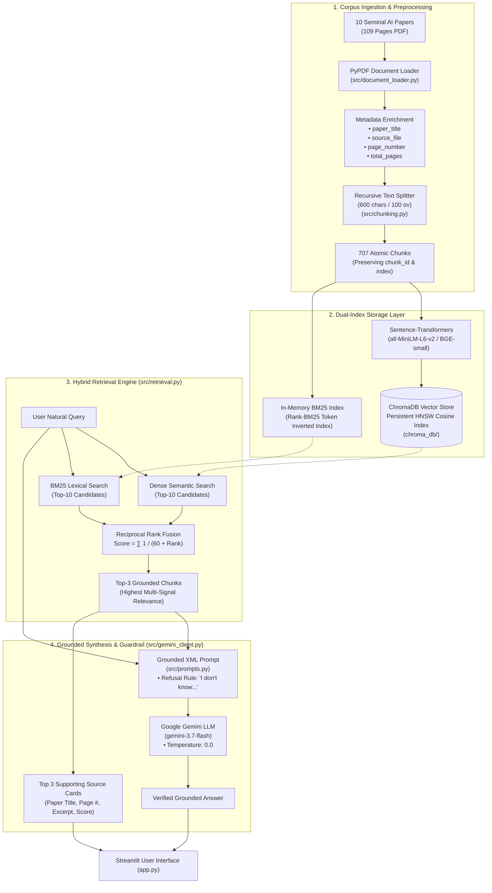
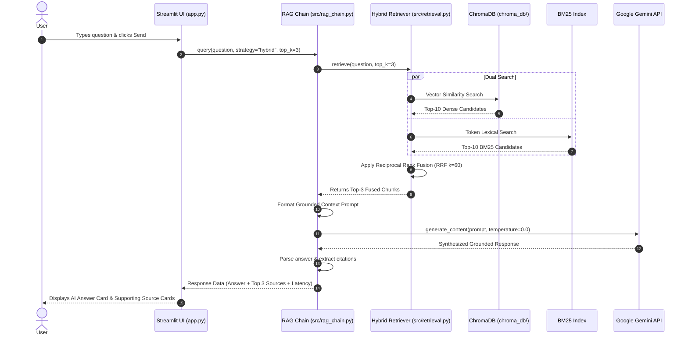

# 🏗️ System Architecture & Engineering Design

**Project:** Research Paper Answer Bot (Grounded RAG Pipeline)  
**Program:** GenAI Pinnacle Plus Capstone Project  
**Tech Stack:** Python, LangChain, Google Gemini API, ChromaDB, Sentence-Transformers, Streamlit  

---

## 📑 Table of Contents
1. [Executive Summary](#1-executive-summary)
2. [End-to-End System Architecture](#2-end-to-end-system-architecture)
3. [Document Ingestion & Chunking Flow](#3-document-ingestion--chunking-flow)
4. [Dual-Index Architecture & Vector Store](#4-dual-index-architecture--vector-store)
5. [Hybrid Retrieval & Reciprocal Rank Fusion (RRF)](#5-hybrid-retrieval--reciprocal-rank-fusion-rrf)
6. [Grounded Prompt Engineering & Hallucination Prevention](#6-grounded-prompt-engineering--hallucination-prevention)
7. [Streamlit UI Component Architecture](#7-streamlit-ui-component-architecture)
8. [Data Flow & Sequence Diagram](#8-data-flow--sequence-diagram)
9. [Error Handling, Fallback & Resilience Matrix](#9-error-handling-fallback--resilience-matrix)

---

## 1. Executive Summary
The **Research Paper Answer Bot** is a modular, production-grade Retrieval-Augmented Generation (RAG) system built over 10 seminal AI research papers (109 pages). The system enforces **strict mathematical and factual ground truth**, returning zero-hallucination responses with verified page-number citations, multi-model embedding support, and 5 selectable retrieval strategies.

---

## 2. End-to-End System Architecture



---

## 3. Document Ingestion & Chunking Flow

### 3.1 Metadata Preservation Schema
Naive RAG systems drop crucial document metadata during text splitting. In this architecture, metadata is encapsulated within a structured schema:

```
Document Page (PyPDF)
├── page_content: str (Raw extracted page text)
└── metadata:
    ├── paper_title: str ("Attention Is All You Need")
    ├── source_file: str ("attention_is_all_you_need.pdf")
    ├── page_number: int (4)
    └── total_pages: int (15)
           │
           ▼  RecursiveCharacterTextSplitter (chunk_size=600, overlap=100)
Chunk Document
├── page_content: str (Passage context)
└── metadata:
    ├── chunk_id: str ("attention_p4_c2")
    ├── chunk_index: int (2)
    ├── paper_title: str ("Attention Is All You Need")
    ├── source_file: str ("attention_is_all_you_need.pdf")
    ├── page_number: int (4)
    └── total_pages: int (15)
```

### 3.2 Splitting Hierarchy
1. Double Newline (`\n\n`): Paragraphs and theorem blocks.
2. Single Newline (`\n`): Equation lines and bullet points.
3. Sentence Boundary (`. `): Discrete claims and findings.
4. Word Boundary (` `): Token-level containment.

---

## 4. Dual-Index Architecture & Vector Store

```
                        User Document Chunks
                                 │
                 ┌───────────────┴───────────────┐
                 ▼                               ▼
     [Dense Vector Index]              [Lexical BM25 Index]
  • Model: all-MiniLM-L6-v2          • Tokenizer: Regex Word Splitting
  • Embed Dim: 384 dimensions        • Weighting: TF-IDF with k1=1.5, b=0.75
  • Distance Metric: Cosine (HNSW)   • Index: In-Memory Inverted List
  • Persistence: ChromaDB on Disk    • Best for: Exact Symbols / Formulas
```

---

## 5. Hybrid Retrieval & Reciprocal Rank Fusion (RRF)

### 5.1 The Mathematical Formulation
When combining dense vector similarity scores $S_{\text{dense}} \in [0, 1]$ and BM25 scores $S_{\text{bm25}} \in [0, \infty)$, linear score combination fails without manual dataset calibration. 

**Reciprocal Rank Fusion (RRF)** eliminates score scale mismatch by ranking items according to their relative position in each candidate list:

$$\text{RRF Score}(d) = \sum_{m \in M} \frac{1}{k + r_m(d)}$$

Where:
- $M = \{\text{Dense Vector Search}, \text{BM25 Lexical Search}\}$
- $r_m(d) \in \{1, 2, \dots, N\}$ is the 1-indexed rank of document $d$ in system $m$.
- $k = 60$ is the standard smoothing constant preventing top-ranked outliers from dominating.

---

## 6. Grounded Prompt Engineering & Hallucination Prevention

```
┌────────────────────────────────────────────────────────────────────────┐
│ SYSTEM PROMPT (Strict Grounded Academic Persona)                       │
│ "You are an expert AI research assistant. Your task is to answer the  │
│ question strictly based on the provided context excerpts below.       │
│                                                                        │
│ MANDATORY RULES:                                                       │
│ 1. Answer ONLY using information explicitly stated in the context.     │
│ 2. If the context does NOT contain enough information, respond exactly:│
│    'I don't know based on the provided papers.'                        │
│ 3. Cite the paper title and page number for every factual claim."      │
│                                                                        │
│ CONTEXT:                                                               │
│ <context>                                                              │
│   <source id="1" title="..." page="...">                               │
│     Passage content...                                                 │
│   </source>                                                            │
│ </context>                                                             │
│                                                                        │
│ USER QUESTION:                                                         │
│ {question}                                                             │
└────────────────────────────────────────────────────────────────────────┘
```

---

## 7. Streamlit UI Component Architecture

```
┌────────────────────────────────────────────────────────────────────────┐
│ TOP HEADER BAR                                                         │
│ 📚 Research Paper Answer Bot               [● Gemini • RAG Active]    │
├───────────────────┬────────────────────────────────────────────────────┤
│ SIDEBAR           │ MAIN INTERACTION CONTAINER                         │
│ • SYSTEM          │ ┌────────────────────────────────────────────────┐ │
│   Gemini API Key  │ │ TAB 1: 💬 Research Assistant                   │ │
│   Status: Ready   │ ├────────────────────────────────────────────────┤ │
│ • MODEL           │ │ Hero / Suggested Question Pills                │ │
│   all-MiniLM / BGE│ │   [ Complexity of Self-Attention ]             │ │
│   Strategy: Hybrid│ │   [ LoRA Weight Freezing ]                     │ │
│   Top-K: 3        │ │                                                │ │
│ • DOCUMENTS       │ │ User Message Bubble                            │ │
│   Papers: 10      │ │   Q: What is the complexity of self-attention? │ │
│   Chunks: 707     │ │                                                │ │
│   [Paper List]    │ │ AI Answer Card                                 │ │
│ • ACTIONS         │ │   The complexity is O(n^2 * d) [Page 4].       │ │
│   Clear History   │ │                                                │ │
│                   │ │ Supporting Source Cards                        │ │
│                   │ │   [01] Attention Is All You Need (Page 4)      │ │
│                   │ │        "Self-Attention: O(n^2 * d)..."         │ │
│                   │ │        ▶ View full passage [Expander]          │ │
│                   │ │                                                │ │
│                   │ │ Search Input: [Ask anything about papers... ]  │ │
│                   │ └────────────────────────────────────────────────┘ │
│                   │ ┌────────────────────────────────────────────────┐ │
│                   │ │ TAB 2: 📊 Corpus & Evaluation Dashboard        │ │
│                   │ │ Metric Cards • 5 EDA Plots • Benchmark Tables  │ │
│                   │ └────────────────────────────────────────────────┘ │
└───────────────────┴────────────────────────────────────────────────────┘
```

---

## 8. Data Flow & Sequence Diagram



---

## 9. Error Handling, Fallback & Resilience Matrix

| Failure Mode | Root Cause | Automated Recovery Mechanism |
|---|---|---|
| **Gemini API 503 Spike** | Temporary peak load on Google servers | Exponential backoff retry loop in `src/gemini_client.py` (up to 3 attempts with 2s, 4s, 8s backoff). |
| **Model Deprecation** | Endpoint name updates | Multi-model fallback list: `["gemini-3.7-flash", "gemini-flash-latest", "gemini-2.5-flash-lite"]`. |
| **Out-of-Scope Query** | User asks non-indexed question | Strict system prompt refusal trigger: `"I don't know based on the provided papers."` |
| **Windows Console Unicode** | Mathematical symbols ($\in, \mathcal{O}$) | Auto-reconfigure `sys.stdout` stream to UTF-8 with `errors='replace'`. |
| **Empty / Missing API Key** | User starts app without `.env` | Safe UI password input field allowing runtime key insertion without restarts. |
